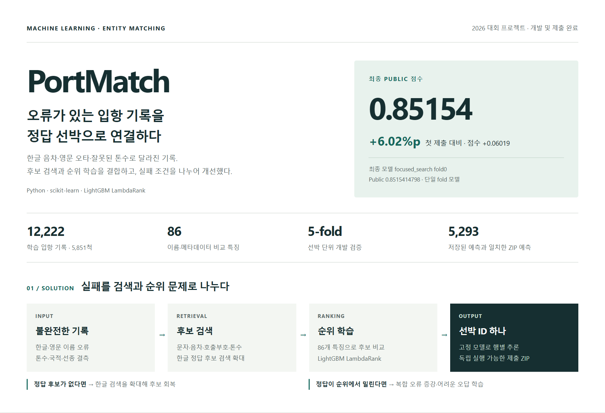
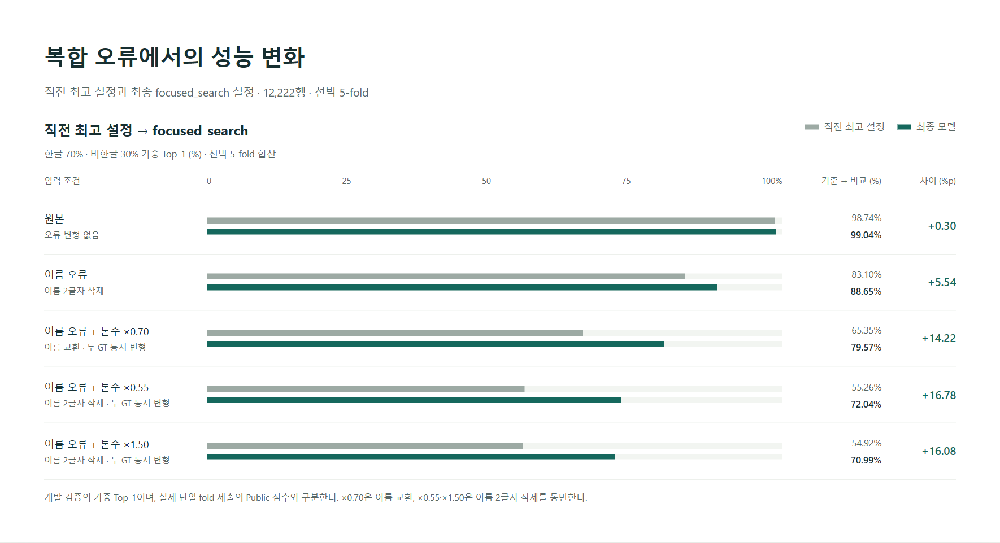

<div align="center">

# PortMatch

**이름과 톤수가 잘못 기록돼도 같은 선박을 찾는 한글·영문 매칭 시스템**

Python · scikit-learn · LightGBM LambdaRank

[포트폴리오 PDF](output/pdf/portmatch-portfolio.pdf) · [최종 모델 코드 안내](docs/final-model.md) · [실험 근거](docs/experiment-evidence.md) · [가상 오류 예시](docs/fictional-examples.md)

</div>



> **Public 0.7914 → 0.8515 (+6.02%p).** 실패를 후보 검색과 순위 선택으로 나누어 개선하고, 다른 오류 조건의 성능 손실까지 비교해 최종 모델을 선택했다.

| 프로젝트 개요 | 내용 |
|---|---|
| 과제 | [항만 문제해결을 위한 AI 기술 공모전](https://dacon.io/competitions/official/236771/overview/description)의 선박 매칭 |
| 프로젝트 구성 | **1인 개인 프로젝트** |
| 개발 데이터 | 입항 기록 **12,222건**, 선박 **5,851척** |
| 본인 담당 | **전 과정 수행:** 문제 정의·데이터 분석 → 후보 검색·86개 특징 설계 → 증강·순위 모델 구현 → 비교 실험·성능 분석 → 대회 제출·제출물 복원·추론 검증 |
| 완료 범위 | 대회 제출과 독립 실행 검증. 개발·실험·제출 **2026-11-02 종료** |
| 최종 모델 | **focused_search fold0**: 선박 5분할 중 한 훈련 부분으로 학습한 단일 모델 |

## 어떤 문제를 해결했는가

입항 기록을 선박 카탈로그의 고유 ID에 연결하는 문제다. 같은 선박도 한글 음차·영문 오타로 이름이 다르고, 비슷한 이름의 다른 선박도 존재한다. 호출부호·총톤수(GT)·국적·선종까지 누락되거나 틀리면 이름의 단순 일치로 연결하기 어렵다.

| 입력 → 후보 검색 → 최종 선택 | 설명용 예시 |
|---|---|
| 입항 기록 | 이름 `블루오션`, 총톤수 `5,500`, 호출부호 없음 |
| 검색 후보 | `BLUE OCEAN`(10,000톤), `BLUE OCEAN II`(5,500톤) 등 |
| 목표 출력 | 다른 항목까지 함께 비교해 정답 선박 ID 하나를 반환 |

*위 이름·수치는 가상 예시이며 실제 예측 결과가 아니다. 톤수가 정확히 일치하는 후보가 항상 정답인 것은 아니라는 문제를 보여준다.*

목표는 **처음 보는 선박의 불완전한 기록에서도 정답을 후보에 포함하고, 유사한 오답보다 높은 순위로 선택하는 것**이다. 초기 공개 데이터 검증과 실제 Public 점수의 차이를 확인한 뒤, 원본뿐 아니라 이름·톤수의 복합 오류를 고정해 비교했다.

## 어떻게 개선했는가

후보 검색으로 비교 대상을 모으고, **LightGBM LambdaRank**로 질의마다 후보의 순서를 학습했다. 이름·음차·수치·범주 정보를 함께 활용하고, 실패를 검색과 순위 단계로 나누어 진단할 수 있는 구조다. 다른 모델 계열보다 우수하다는 비교 결과를 뜻하지는 않는다.

| 확인한 문제 | 적용한 방법 | 확인한 지표 |
|---|---|---|
| 정답이 후보에 포함되지 않음 | 이름 정규화·문자·음차·호출부호·톤수 검색, 한글 후보 검색 확대 | 정답 후보 포함 여부 |
| 후보에 있는 정답이 순위에서 밀림 | 86개 특징의 LightGBM 순위 학습, 복합 오류 증강, 어려운 오답 학습 | 최종 1위 정답률·순위 오류 |
| 반복 입항 기록으로 인한 정보 누출 위험 | 외부 선박 5-fold, 사전·통계 생성에 내부 분할 적용 | 선박 분리·학습 정보 범위 |
| 특정 오류 개선과 다른 조건의 성능 하락 | 보강 방법별 비교, 원본·기존 오류 조건의 유지 기준 설정 | 조건별 개선·하락·모델 채택 여부 |

최종 추론은 **고정된 검색 자산과 모델로 한 행씩 독립적으로 수행**한다. 추가 검색이 기존 후보의 특징을 바꾸지 않도록 보존하고, 입력 순서·다른 행의 예측에 의존하지 않는다. [최종 추론 코드](portmatch/focused_runtime.py) · [한글 검색 확대](portmatch/hangul_expansion.py) · [시스템 구조](docs/architecture.md)

## 실제 제출 성과

| 제출 모델 | Public 점수 | 판단 |
|---|---:|---|
| 첫 86개 특징 단일 모델 | 0.7914 | 첫 제출 기준 |
| robust 검색 + 톤수 결측 증강 | 0.8425 | 직전 최고 |
| 전체 공개훈련 모델 | 0.8324 | 점수 하락으로 미채택 |
| **최종 focused_search 단일 모델** | **0.8515** | **최종 채택** |

Public 점수는 프로젝트에 기록된 제출 결과 기준이다. 최종 원점수는 **0.8515414798**이며 상세 수치와 기록의 확인 범위는 [제출·검증 근거](docs/experiment-evidence.md)에 명시했다. Private 점수·최종 순위는 미확인이다. 각 변경의 기여는 개발 실험에서 비교했으며 전체 Public 상승분을 특정 기법 하나의 효과로 해석하지 않았다.

## 오류 조건에서의 개선



**직전 제출 최고 설정과 최종 설정의 전체 5-fold 개발 검증**이다. 한글 70%·비한글 30%의 가중 Top-1이며 실제 단일 모델의 Public 점수와 구분한다. ×0.70은 이름 문자 교환, ×0.55·×1.50은 이름 2글자 삭제를 동반한다. [전체 조건과 계산 근거](docs/evidence/tonnage-repair.json)

**모든 조건이 동시에 좋아진 것은 아니다.** 최종 설정은 직전 제출 최고보다 개선됐지만, 중간 조합 증강 모델 대비 일부 조건은 하락해 당시 유지 기준을 통과하지 못했다. 별도 제출에서 Public 상승을 확인해 최종 채택했고, 이후 보강 실험은 아래 손실 때문에 미채택했다. [기준별 비교와 채택 경위](docs/experiments/tonnage-repair-5fold.md)

<details>
<summary><strong>후속 모델을 채택하지 않은 이유</strong></summary>

focused_search를 기준으로 이름 보강·×0.70 주변 톤수 보강·동시 적용을 분리해 **25조건·전체 5-fold**로 비교했다. 이름 보강은 이름 오류를, 톤수 보강은 ×0.70을 개선했지만 세 모델 모두 사전 유지 기준을 통과하지 못했다.

| 후속 동시 보강의 조건 | focused_search 대비 변화 |
|---|---:|
| 이름 교환 + 두 톤수 ×0.70 | +3.02%p |
| 이름 2글자 삭제 + 두 톤수 ×0.55 | −3.53%p |
| 원본 | −0.36%p |

후보 집합은 같았으며 변화는 순위 선택에서 발생했다. 핵심 조건인 원본·×0.55·×1.50을 전체 합산과 제출용 fold0에서 함께 확인하고 **기존 focused_search를 유지**했다. [보강별 효과·신뢰구간·유지 판정](docs/experiment-evidence.md)

</details>

## 재현성 및 완료 범위

- **제출물 복원:** 최종 모델·검색 자산·실행 소스를 독립 실행 가능한 ZIP으로 패키징했다. [패키징 코드](portmatch/focused_submission_package.py) · [제출 진입점](submission_focused/script.py)
- **추론 일치:** 원본·역순·부분·단일·변형 입력을 포함한 **5,293개 예측이 저장된 실험 예측과 모두 일치**했다. 정확도 100%가 아니라 패키지 재현성 검증이다. [검증 코드](scripts/verify_focused_submission.py) · [집계 기록](docs/evidence/submission-verification.json)
- **결과 보존:** 기존 모델·제출물을 덮어쓰지 않고, 파일 해시로 변경 여부를 확인했다.
- **남은 한계:** 한글 데이터는 1,191건·382척으로 작고 같은 검증 집합을 반복 사용했다. 제출용 fold0의 내부 원본 점수 98.02%와 Public 85.15% 사이에 차이가 남았다. 비공개 데이터의 실패 원인은 직접 확인하지 못했다. 운영 배포·실제 업무 절감 효과 측정은 수행하지 않았다.

## 공개 범위

이 저장소는 **코드·집계 결과 중심의 포트폴리오 공개본**이다. 원본 대회 데이터, 실제 행별 오류 사례, 학습된 검색 사전·가중치, 제출 ZIP은 포함하지 않는다. 설명용 이름·수치는 가상으로 작성했으며 실제 데이터와의 대응표는 제공하지 않는다. 기존 개발 저장소와 모델·제출물은 비공개로 보존했다.

[공개 자료와 재현 범위](docs/public-release.md) · [검색·순위 오류의 가상 예시](docs/fictional-examples.md)

## 문서와 시각자료

| 자료 | 내용 |
|---|---|
| [공유용 PDF](output/pdf/portmatch-portfolio.pdf) | 2쪽 요약과 비교 실험·모델 선택 |
| [최종 모델 코드 안내](docs/final-model.md) | 추론·검색·학습 코드 연결, 합성 데이터 테스트, 재현 범위 |
| [실험 근거](docs/experiment-evidence.md) | 단계별 효과 분리, 전체 조건 집계, 신뢰구간과 미채택 판단 |
| [프로젝트 요약 이미지](docs/portfolio/readme-summary.png) | 문제 해결 구조와 핵심 성과 |
| [오류 조건별 성능 그래프](docs/portfolio/readme-performance.png) | 직전 최고 설정과 최종 설정의 개발 검증 |
| [학습·실험 안내](TRAINING.md) | 데이터 준비, 재현 명령, 실험 기록 |

<details>
<summary><strong>코드 구조와 실행 환경</strong></summary>

```text
portmatch/          # 후보 검색, 특징 생성, 순위 학습과 추론
scripts/            # 실험 실행과 제출 검증
tests/              # 합성 데이터 기반 회귀·누수 방지 테스트
docs/               # 설계, 실험 결과, 포트폴리오
output/pdf/         # 공유용 포트폴리오
TRAINING.md         # 데이터 준비와 재현 명령
```

Python 3.11 기준이며 실행 의존성은 [requirements.txt](requirements.txt)에 고정했다. 소스와 집계 결과를 공개하며 원본 대회 데이터·훈련 캐시·모델·제출 ZIP은 Git에 포함하지 않는다. **합성 데이터 테스트는 실행할 수 있으며, 실제 모델 추론에는 보존된 모델 자산이, 전체 학습에는 공식 데이터와 선행 단계의 산출물이 필요하다.** [최종 모델과 재현 범위](docs/final-model.md) · [학습 기록](TRAINING.md)

</details>

개발·실험·제출은 **2026-11-02 종료**, 포트폴리오 정리는 **2026-11-07** 기준이다. 기존 종료 보고서·모델·제출물·프로젝트 보관 ZIP은 보존했다.
