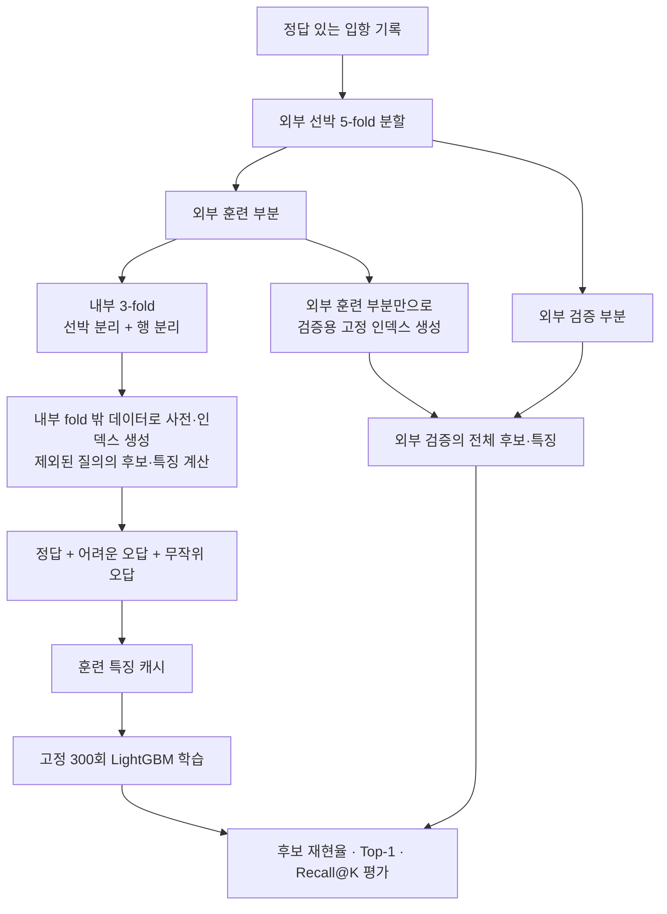

# PortMatch 아키텍처

[최종 코드와 재현 범위](final-model.md) · [실험 근거와 모델 선택](experiment-evidence.md)

2026-11-02 종료 기준 최종 모델은 **focused_search fold0**다. [종료 보고서](project-closeout.md)에 결과와 보존 경로를 기록했다. 아래 설계와 초기 구현 기록을 유지하며, 최종 추론 구성은 다음과 같다.

고정 robust 검색 인덱스의 후보에 `HangulExpansion`으로 최대256개 선박을 추가한다. 기존 후보의86개 특징은 유지하고 추가 후보의 특징을 별도로 계산한 뒤 focused 순위 모델로 함께 평가한다. `FocusedMatcher`가 이 흐름을 한 행씩 독립적으로 수행한다. 가중치·검색 인덱스·추가 검색 인덱스·실행 소스를 모두 제출 ZIP에 담아 원래 실험 폴더 없이 복원한다.

최종 구현은 `portmatch/focused_runtime.py`, 패키징은 `portmatch/focused_submission_package.py`, 제출 진입점은 `submission_focused/script.py`다. 최종 ZIP은 `submissions/focused_search_fold0/submit.zip`이며 기존 `submission/script.py`와 기존 패키징 경로도 보존한다. 대회 데이터가 준비되면 ZIP 안의 `script.py`로 추론하며, 소스만으로 과거 전체 학습을 재현할 때는 별도의 공식 데이터·훈련 캐시가 필요하다.

[프로젝트 개요](../README.md) · [학습·실험 명령](../TRAINING.md) · [후보 검색 상세](retrieval.md)

## 설계의 중심

입항 기록과 선박 카탈로그를 연결하는 두 단계 모델입니다. 검색은 정답을 놓치지 않는 데 집중하고, 순위 모델은 넓게 모은 후보 중 정답을 선택합니다. 카탈로그는 고정 후보 모집단이고, 조회 사전·관측 이름·국적·선종 통계는 사용이 허용된 훈련 부분에서만 만듭니다.

검증의 핵심 단위는 **선박**입니다. 같은 선박의 반복 입항으로 조회 정보가 새어 들어가지 않도록 외부 검증을 선박 단위로 분리합니다. 학습용 특징에도 내부 분할을 적용합니다.

## 학습 데이터 흐름

외부 검증 데이터는 모델 학습이나 조기 종료에 사용하지 않습니다. 내부 행 분리에서는 다른 행의 동일 선박이 재입항 사례로 등장할 수 있지만, 해당 질의 자체와 외부 검증 선박은 제외합니다. 내부 선박 분리는 처음 보는 선박의 관점을 제공합니다. 기본 `mixed`는 두 관점의 학습 그룹을 생성합니다.

## 주요 컴포넌트

| 모듈 | 책임 | 유지해야 할 조건 |
|---|---|---|
| `data.py` | CSV 읽기, 필수 열·ID 검사 | ID 중복과 누락된 정답을 방치하지 않음 |
| `text.py` | 정규화와 기본 전사 | 입력 이름만으로 결정되는 변환 |
| `memory.py` | 호출부호·이름 조회, 관측 이름 별칭 | 생성 시 넘긴 훈련 부분만 사용 |
| `retrieval.py` | 조회·문자·음차·편집·톤수 후보 합집합 | 정답 ID로 후보를 강제로 추가하지 않음 |
| `robust_retrieval.py` | 선택적 한글 문맥·모음 검색 및 두 GT 후보 결합 | 기존 후보 보존, 훈련 부분의 별칭만 사용, 별도 버전·코드/인덱스 해시 |
| `features.py` | 기본 70개 질의–후보 특징, 국적·선종 범주 통계 | 범주 통계는 훈련 부분만 사용, ID·정답 열 금지, 결측은 NaN과 유효성 표시 |
| `pipeline.py` | 위 컴포넌트 연결 | 추론 중 학습 상태 갱신 없음 |
| `training_data.py` | 내부 OOF, 외부 검증 전체 후보, 분할 기록 | 검증·내부 제외 행과 훈련의 중복 검사 |
| `gt_augmentation.py` | 훈련 GT 결측 3종, 중복 제외, 원본/view 질량 정책 | 원본 분할·fitting 유지, 원본별 질량 합 1, 검증 증강 금지 |
| `gt_reweight_cache.py` | 기존 증강 캐시의 원본 질량만 변경, 별도 파생 증명 생성 | 입력 캐시 불변, 후보·X·라벨·순서 비트 동일, 원본 검증 파일 동일 |
| `sampling.py` | 어려운 오답 96개 + 무작위 오답 32개 | 훈련에만 적용, 질의별 결정적 샘플링 |
| `ranking.py` | LambdaRank 학습, 모델 저장·복원, 지표 | 특징 이름·순서 일치, 고정 학습 횟수 |
| `ranker_commands.py` | 데이터 준비·학습·추론 실행 | 출처·특징 코드 검사와 완료 상태 기록 |
| `ranker_comparison.py` | 비교 조건 검사, 개선·신규 오답 집계 | 같은 검증 ID·정답·후보 조건을 확인 |
| `retrieval_comparison.py` | 원본·톤수 변형의 실제 검색·순위·시간 및 선박별 비교 | 같은 분할·모델 가중치로 후보 교체 비교, 원본 기준 예측 일치 확인 |

`name_features.py`는 원래 질의 이름과 고정 카탈로그 이름만으로 17개 특징을 계산합니다. 학습된 별칭, 정답 ID, 호출부호와 범주 통계를 새 이름 특징 계산에 사용하지 않습니다. 기존 OOF 특징은 캐시에서 그대로 복사합니다.

## 후보 검색과 특징의 경계

조회와 검색이 동일 선박을 여러 번 찾으면 선박별로 병합하면서 각 경로의 점수·순위를 보존합니다. 검색 경로의 수나 순위도 모델이 선택적으로 사용할 수 있는 특징입니다.

기본 톤수 검색 범위는 `abs(query - catalog) / catalog <= 0.10`입니다. 특징의 수치 상대오차는 `abs(query - catalog) / max(query, catalog)`를 사용하므로 검색 경계와 모델 입력을 구분합니다. GT와 DWT를 직접 비교하지 않습니다.

학습에서 정답 후보를 찾지 못하면 해당 그룹을 기록하고 건너뜁니다. 검증에서 같은 일이 생기면 검색 실패로 평가합니다. 후보가 수천 개여도 검증에서는 전체를 유지합니다.

## 캐시와 모델 번들

| 로컬 산출물 | 내용 | 용도 |
|---|---|---|
| `runs/ranker_data_foldN/` | 원본 70열, 후보 그룹, 분할, 인덱스, 메타데이터 | 검색·내부 OOF 계산 재사용 |
| `runs/ranker_data_token_phonetic_foldN/` | 원본 70열 + 이름 17열, 동일 후보·샘플·순서 | 통제된 조건에서 이름 특징 비교 |
| `artifacts/ranker_no_tonnage_rank_foldN/` | 69개 선택 모델, 인덱스, 특징 목록, 검증 예측 | 이전 기준·비교 대조군 보존 |
| `artifacts/ranker_token_phonetic_foldN/` | 86개 선택 모델과 변환 정보 | 현재 개발 기준과 개별 질의 추론 |
| `runs/ranker_data_ch_variants_foldN/` | 이름 87열 + CH 7열, 기존 배열 보존 | fold1·2 완료, 나머지 미실행 |
| `artifacts/ranker_ch_variants_foldN/` | 톤수 순위를 제외한 93개 실험 모델 | fold1·2 비교 후 미채택 |
| `runs/compare_*/` | 합산·fold별 지표, 행·선박별 변화 | 개선과 손실을 함께 판단 |
| `submissions/baseline86_fold0/submit.zip` | 고정 86개 fold0 모델·실행 코드·최소 추론 메타데이터 | 첫 서버 실행 확인용 제출 파일 |
| `work/submission_validation/baseline86_fold0/` | ZIP별 실행 입력·출력·시간·독립성 검증 | 로컬 검증 근거 보존 |

이 경로들은 로컬 생성물이며 GitHub에는 포함하지 않습니다. 새 환경에서는 데이터를 준비하고 명령을 실행해 생성합니다.

`feature_selection.py`는 캐시 열을 포함하거나 제외할 때 원래 순서를 보존합니다. 선택 목록을 모델과 함께 저장해 검증·추론에 동일하게 적용합니다. `feature_transforms.py`는 원본과 파생 캐시의 관계를 확인합니다. `name_feature_cache.py`는 후보·정답·그룹·순서·기존 특징을 보존하고 새 특징만 추가합니다. `tonnage_rank.py`는 동점 보정 순위 실험의 별도 변환입니다.

특징 코드는 파일 바이트를 해시하므로 **코드 내용뿐 아니라 줄바꿈 변경도 기존 캐시와의 호환성 검사에 영향을 줄 수 있습니다.** `.gitattributes`는 Python 파일의 자동 줄바꿈 변환을 막아 원본 바이트를 보존합니다. 실제 특징 계산을 바꾼 경우에는 기존 캐시를 그대로 쓰지 않고 새 버전으로 다시 준비합니다.

모델 번들의 `training_summary.json`에는 완료 여부, 선택 특징, 학습 설정, 데이터 메타데이터와 지표가 들어갑니다. 복원한 `RankedMatcher`는 훈련 캐시 없이 고정 인덱스로 검색하고 같은 변환·선택을 적용해 점수를 계산합니다. 동점은 고정 선박 ID 순서로 결정합니다. 모델 점수와 점수 차이는 확률이 아닙니다.

## 평가와 비교

훈련 결측 증강은 `prepare-ranker --retrieval-profile robust --gt-augmentation missing`으로 선택합니다. 훈련 NPZ에만 `augmentation_variant`·`query_mass`가 추가되며 70→87열 변환에서도 유지됩니다. 내부 분할은 원본으로 먼저 결정하고 fitting 데이터에는 마스크를 넣지 않습니다. 각 변형에서 새 후보·특징·오답을 생성한 뒤 보존된 source의 총 질량 1을 view와 원본/변형 사이에 배분합니다. `ranking.py`는 이 질량에 언어별 균형·후보 수 보정을 적용해 LightGBM 행별 가중치로 전달합니다. 메타데이터는 질량·제외 내역·출처를 검증하며 정확한 86개 특징을 요구합니다.

`compare-retrieval --reference-model`은 증강 없는 robust 모델과 증강 모델을 같은 입력으로 직접 비교합니다. 두 모델의 검색·분할·사전·특징·학습 설정과 후보 집합이 같아야 하며, baseline/reference/trained 모두 저장된 원본 예측과 일치해야 합니다. 설계·산출물·실행 명령은 [GT 결측 증강](experiments/gt-missing-augmentation.md)에 있습니다. 실제 전체5-fold 실행·분석을 완료했습니다. 원본98.7385%는 기존 대비−0.1682%p이며 한글3건 순손실로 기준 교체를 보류합니다. 전체 원본 샘플 후보·라벨·질량 정책과 원본 검증NPZ193개 동일성을 확인했습니다. [전체 결과·채택 판단](experiments/gt-missing-5fold.md)을 기록했습니다.

`reweight-ranker-cache`는 완료된 증강 87열 캐시를 별도 폴더로 복사하고 훈련 `query_mass`만 바꿉니다. 메타데이터의 `training_reweighting`과 `reweighting.json`이 기존 특징 변환 증명과 별도로 질량 변경의 출처를 보증합니다. 학습 전 파일·배열 보존과 source/view 질량 정책을 검사합니다. `compare-retrieval --control-model`은 정확한 원본 캐시를 사용한 기존 0.5 모델을 추가하여 0.75와 직접 비교하며, 증강 전 reference와의 비교도 유지합니다. [질량 정책·fold1 명령](experiments/gt-reweighting.md). 실제0.75 전체5-fold 학습·비교·파일/배열 보존 감사를 완료했습니다. 0.5 대비 원본+0.1094%p이나 국제 GT ×1.25 −1.3600%p로0.75는 미채택하고0.5를 유지합니다. [최신 전체 결과·다음 계획](experiments/gt-reweighting-5fold.md).

- **후보 재현율:** 정답을 후보에 포함했는지. 검색 단계의 상한을 확인합니다.
- **Top-1·Recall@K:** 정답이 순위의 어디에 놓였는지. 한글·비한글을 나눠 집계합니다.
- **가중 Top-1:** 한글 0.7, 비한글 0.3의 가중 합입니다. 전체 5-fold는 언어별 예측을 모아 계산하며 fold 점수를 단순 평균하지 않습니다.
- **행별 변화:** 개선, 신규 오답, 기존 오답 유지와 정답 순위 변화를 기록합니다.
- **선박별 변화:** 반복 입항을 묶어 어떤 선박이 개선·악화됐는지 확인합니다.

일부 fold나 표본 제한이 있는 결과는 전체 검증과 구분합니다. 반복적으로 사용한 개발 fold는 독립 테스트로 취급하지 않습니다.

## 구현 범위와 다음 단계

현재 구현은 데이터 검사 → 후보 검색 → 내부 OOF 특징 → 오답 샘플링 → 순위 학습 → 전체 후보 평가 → 저장 모델의 행별 추론까지 연결됩니다. 합성 데이터 기반 테스트로 조회 충돌, 누수, 후보 보존, 특징 선택·변환, 저장·복원과 캐시/실시간 추론 일치를 점검합니다.

현재 채택 기준은 **86개 특징**입니다. 원본 70개 + 이름 17개로 87열 캐시를 만들고 `retrieval_tonnage_rank`를 제외합니다. 같은 외부 선박 5-fold 전체 12,222행에서 69개 대비 가중 Top-1이 97.0368%→98.9067%로 개선돼 새 개발 기준으로 채택했습니다. 비한글 정확도 하락과 fold 1의 퇴행은 후속 실험에서 확인할 과제이며, 69개 모델은 대조군으로 보존합니다. 세부 결과는 [전체 비교 기록](experiments/token-phonetic-5fold.md)에 있습니다.

제출 인터페이스와 ZIP 생성은 구현했고, 로컬에서 전체·역순·부분집합·단독 입력의 실제 예측 일치를 검증했습니다. 첫 DACON 제출은 **Public 0.7913544371, 화면 표시 14분 15초**로 점수가 산출됐습니다. 같은 fold0 모델의 로컬 가중 Top-1 0.9802914710과 큰 차이가 있어, 공개 입력의 톤수 결측·오차 진단을 추가했습니다. 한글 48척의 후보 재현율이 48/48에서 두 조건 모두 31/48로 떨어져 이름 후보 검색과 두 GT 범위 결합을 후속 구현했습니다. [검색 교체 fold0 전체 비교](experiments/robust-retrieval-fold0.md)에 이어 [robust 재학습 분석](experiments/robust-retrained-fold0.md)까지 완료했습니다. 원본 신규 2행·국제 GT 결측 신규 19행으로 증강 없는 재학습 모델의 단독 채택·확대를 보류하고 증강 비교의 대조군으로 보존했습니다. 후속 GT 결측 증강 fold0 분석을 완료했고 국제 GT 결측·오차가 크게 개선됐습니다. 원본 손실은 남았지만 이후 동일0.5의 전체5-fold에서 변형 개선을 확인했고 두 번째 제출 점수0.8424607623을 사용자 보고로 기록했습니다. 후속0.75 전체5-fold는 강건성 손실로 미채택했습니다. 상세 진단 근거와 한계는 [첫 제출 분석](experiments/first-public-submission.md)에 있습니다. 외부 선박 사전이나 특정 검증 선박에 맞춘 예외 매핑은 사용하지 않습니다.

새 검색은 `RobustMatchingPipeline`을 모든 내부 OOF 및 외부 훈련 인덱스 생성에 적용합니다. 후보가 달라지므로 새 70열 캐시부터 만들며, 기존 이름 특징 변환으로 87열을 만든 뒤 86개를 선택합니다. 검색 확장의 코드·설정과 저장 인덱스 해시가 맞지 않으면 로드·학습을 중단합니다. 동일 후보를 전제로 하는 기존 비교는 계속 거부하며, 별도의 `compare-retrieval`로 검증합니다. 현재 제출 빌더는 기존86개와 검증한 robust·86개·0.5 fold0 프로필(`--allow-robust`)을 지원합니다. 전체 공개훈련은 별도 `--allow-full` 프로필로 지원하며 원본 전체·OOF·질량·특징 변환 증명을 검사합니다. 미채택한 재가중치 모델은 허용하지 않습니다.

첫 후속 [CH 실험](experiments/ch-variants-fold12.md)은 fold1·2 본 비교까지 완료했고 개선0행·신규오답1행으로 미채택했습니다. 기존 이름 특징 구현을 보존한 새 모듈이 CH 발음쌍 하나를 선택해 토큰·잔여 모음을 일관되게 계산합니다. 새 캐시는 원본→87열→94열의 파생 관계를 확인하고 직접 부모 86개 모델과만 통제 비교합니다. 구7개→새CH7개 교체 대조는 아직 구현하지 않았고, 첫 Public 결과 이후 검색의 톤수 의존성 보완보다 우선순위를 낮췄습니다.

제출 경로는 `submission_package.py`가 기존 86개 모델의 native 가중치·고정 인덱스·필요한 코드와 최소 추론 메타데이터를 ZIP으로 묶습니다. 코드 바이트·특징 스키마·모델과 인덱스의 해시를 검사하고, 원본 데이터·캐시·검증 보고서는 제외합니다. ZIP의 `model/package_manifest.json`에는 파일별 해시와 크기, fold와 모델 출처가 들어갑니다.

`submission/script.py`는 실행 파일 위치를 기준으로 `data/test.csv`와 `data/vessel_catalog.csv`를 읽고, 패키지 해시와 고정 카탈로그의 호환성을 확인합니다. 카탈로그 행 순서는 ID로 정렬해 비교하므로 예측에 영향을 주지 않습니다. 같은 `RankedMatcher`로 각 행을 처리한 뒤 입력 순서대로 `output/submission.csv`를 저장합니다. 테스트 행으로 사전·통계·모델을 갱신하지 않으며 기록에는 집계된 진행률과 시간만 남깁니다.

`scripts/verify_submission.py`는 ZIP을 별도 작업 폴더에 풀어 격리 모드의 새 Python 프로세스로 실행합니다. 공개 fold0 검증의 전체 2,452행, 역순 2,452행, 한글·비한글 각 32행의 부분집합, 단독 1행에서 저장된 예측과의 일치·행별 독립성·입출력 무결성을 검사합니다. 현재 측정 범위와 제출 상태는 [제출 준비 상태](submission-readiness.md)에 기록합니다.

robust·86개·0.5 설정을 고정한 전체 공개훈련 단일 모델의 실제 학습과 ZIP 검증까지 완료했습니다. `full_training_data.py`는 내부 OOF와 전체 원본 추론 사전을 분리하고, `full_ranking.py`는 검증 점수 없이 고정 설정으로 학습합니다. `full_submission_package.py`와 `verify_full_submission.py`는 전체훈련 증명·ZIP·실제 입출력·행별 독립성·시간 검증을 담당합니다. 구현 당시281개 테스트를 통과했고 이후 공개12,222행·5,851척의 전체 모델에서 ZIP6조건 일치를 확인했습니다. 원본 전체 실행은 로컬1,281.59초입니다. 후속 사용자 보고 Public0.8324345055는 기존 fold0보다−1.0026%p여서 교체를 보류합니다(전체훈련 ZIP 제출 경로 사용자 확인). 검색 설정이 같아도 훈련 별칭을 포함한 TF-IDF·조회 사전·범주 통계는 달라지므로, 가중치를 고정한 사전 범위 진단을 후속 설계합니다. [전체 결과·설계·완료 명령](full-training.md).
